# Aether

一个追求沉浸感的 iOS 浏览器：界面几乎不存在，内容铺满屏幕。支持 iPhone 和 iPad。

## 界面预览

以下为 iPhone 18 Pro 模拟器实拍。

| 首页 | 隐藏式快捷操作栏 | 网站收藏页 |
| --- | --- | --- |
| 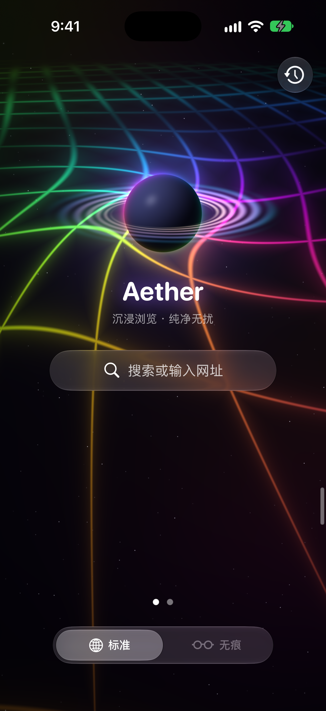 | 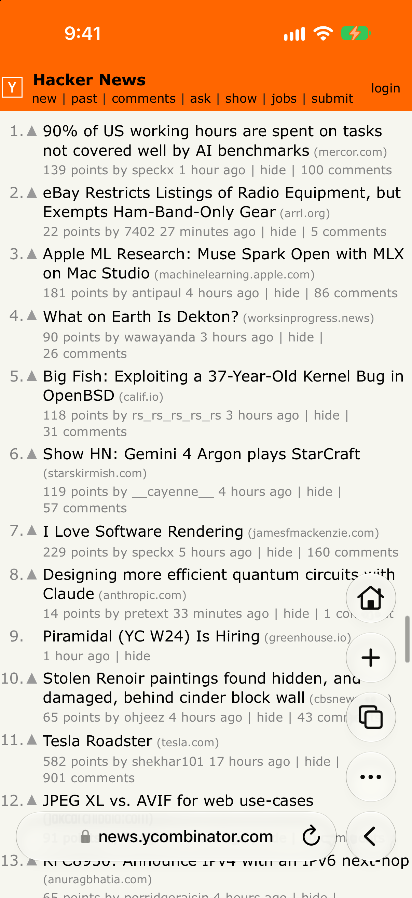 | 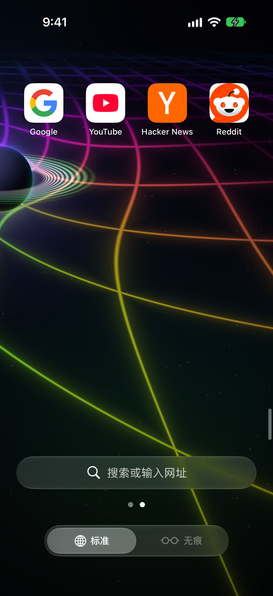 |

首页提供实时星球背景和标准 / 无痕切换。快捷操作栏平时收起为屏幕边缘的细竖线，点击展开后可返回、刷新、回首页、新建或切换标签页；在首页向左翻页即可打开网站收藏。

**YouTube 全屏播放**：侧边播放控制与贴底进度条，画面上没有整块蒙版。

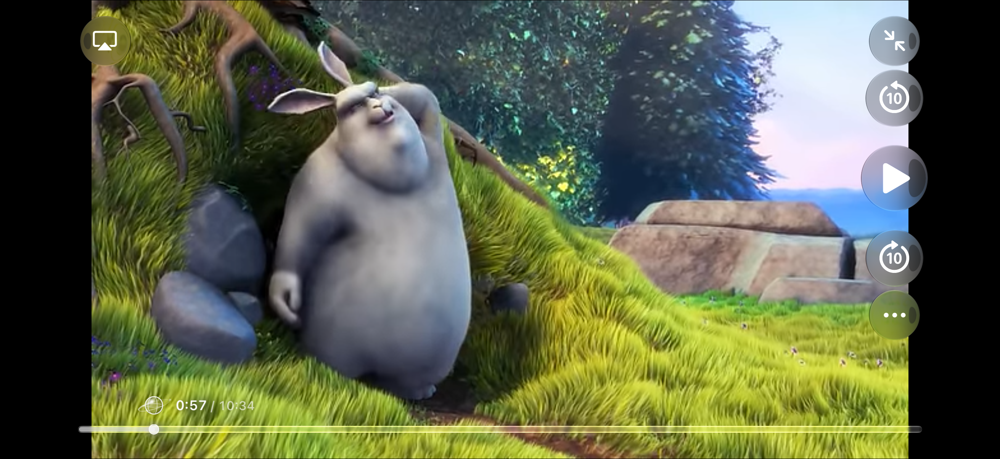

**自动画中画设置**：在播放器的「⋯」菜单中切换，同时可设置常显进度条、旋转屏幕和播放速度。

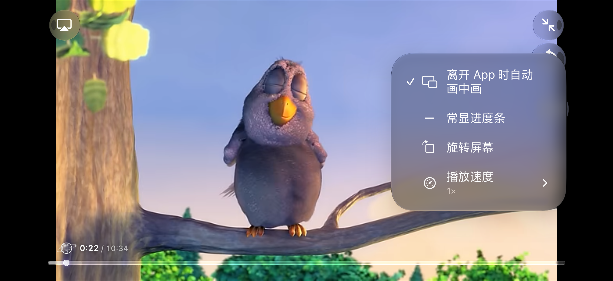

此图展示画中画开关；本次模拟器环境未提供可用的 PiP 浮窗入口，未展示浮窗效果。实际可用性取决于设备与网站播放器。

**视频下载入口**：打开直链视频后，点击屏幕边缘的细竖线展开操作按钮，再在「⋯」菜单中选择「下载此文件」。

| 下载操作入口 | 视频下载完成 |
| --- | --- |
| 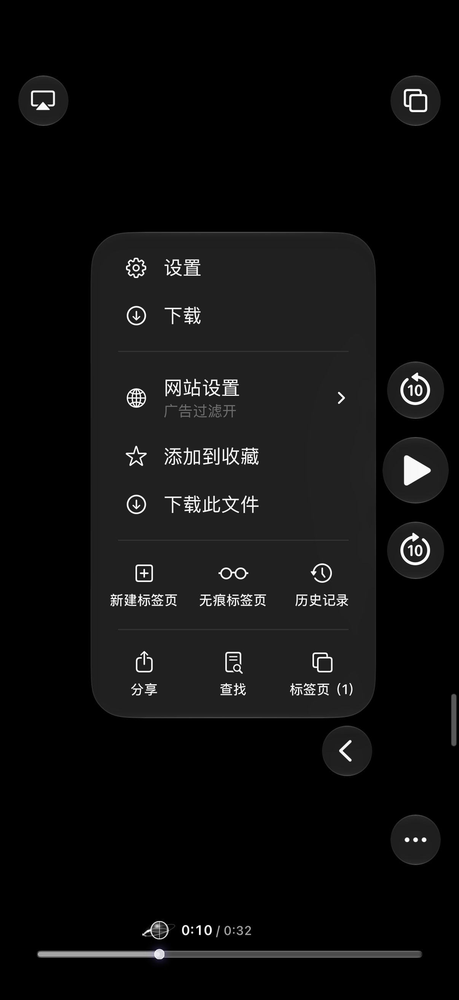 | 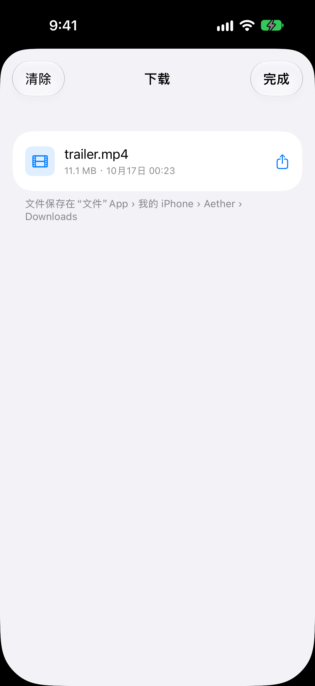 |

下载示例使用可直接访问的 MP4 文件，可在应用内预览、分享，或通过「文件」App 查看。此处演示的是直链视频下载。

### iPad

以下为 iPad Pro 11 英寸（M5）模拟器实拍。iPad 上横竖屏都能用，也支持分屏和台前调度；界面按窗口宽度排版，窗口缩窄后自动回到手机布局。

**横屏首页与网站收藏**：收藏页横屏一排 10 个（10 × 3），竖屏一排 6 个（6 × 5），转屏只重新排列，不会把收藏挤到别的屏。

| 横屏首页 | 横屏网站收藏 |
| --- | --- |
| 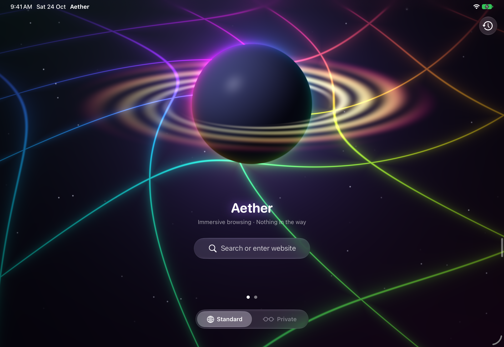 | 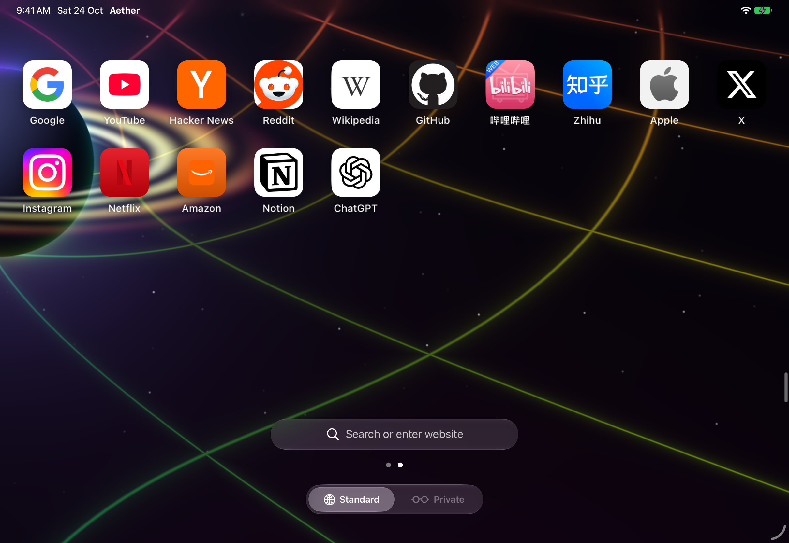 |

**横屏浏览与搜索**：工具栏展开后贴在竖线一侧，不挡正文；点地址栏时，收藏按屏幕宽度排列，地址输入框居中。

| 横屏浏览网页 | 横屏搜索 |
| --- | --- |
| 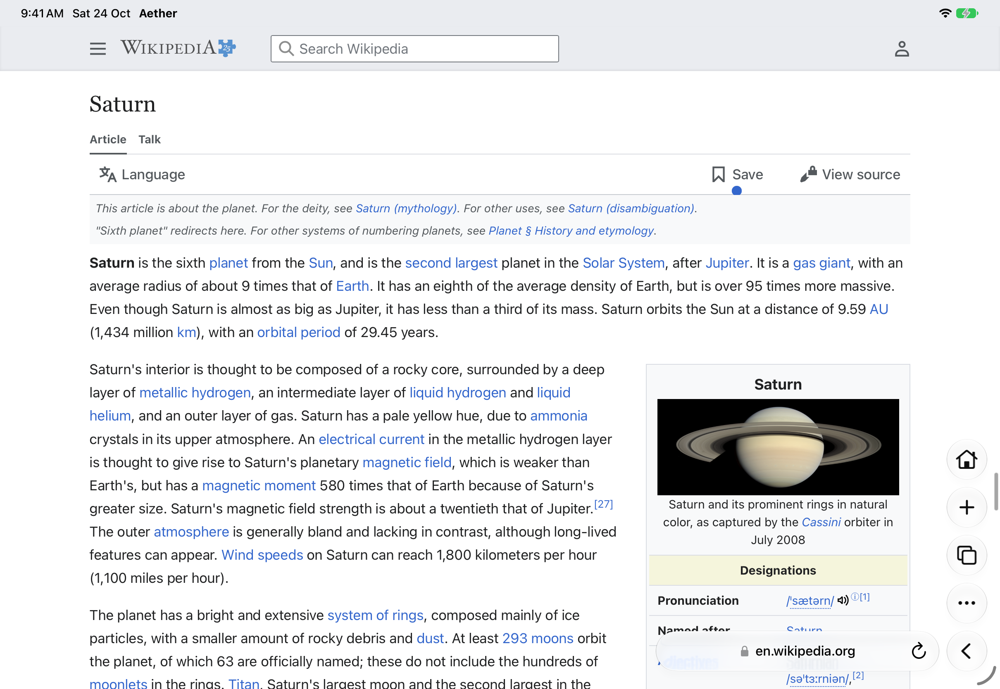 | 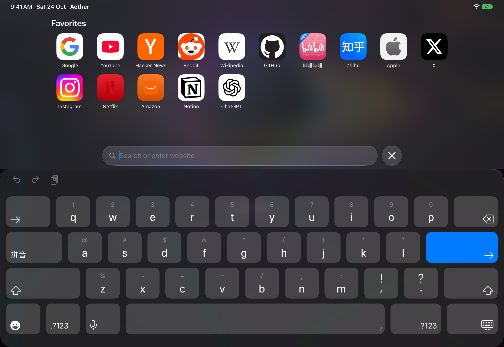 |

**竖屏网站收藏**：

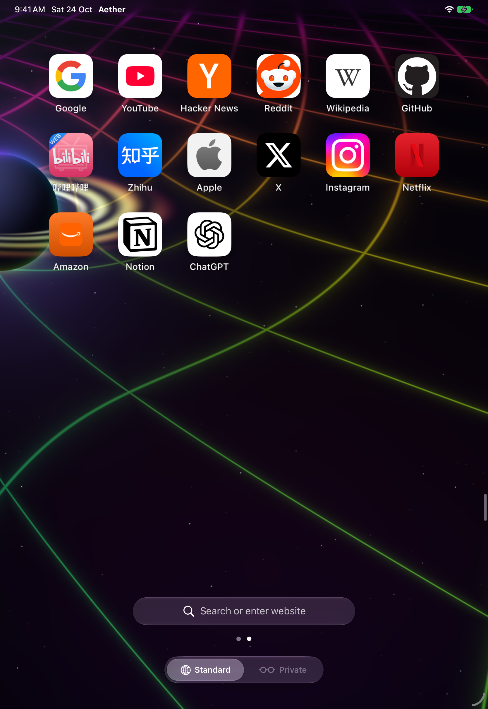

### 网页翻译

以下为 iPad Pro 11 英寸真机实拍。Safari 自带的翻译经常漏掉点餐页这类动态网页；Aether 的翻译只要文字显示在屏幕上就翻：后插入的内容、原本隐藏后来展开的内容、Shadow DOM、iframe、输入框提示文字都包括在内，图片、canvas 和背景图里的字会先在本机识别，再把译文盖在原来的位置。

**点餐页（泰文 → 简体中文，ChatGPT）**：菜单、价格、按钮、促销信息和图片里的字一起翻好。

| 原文 | 翻译后 |
| --- | --- |
| 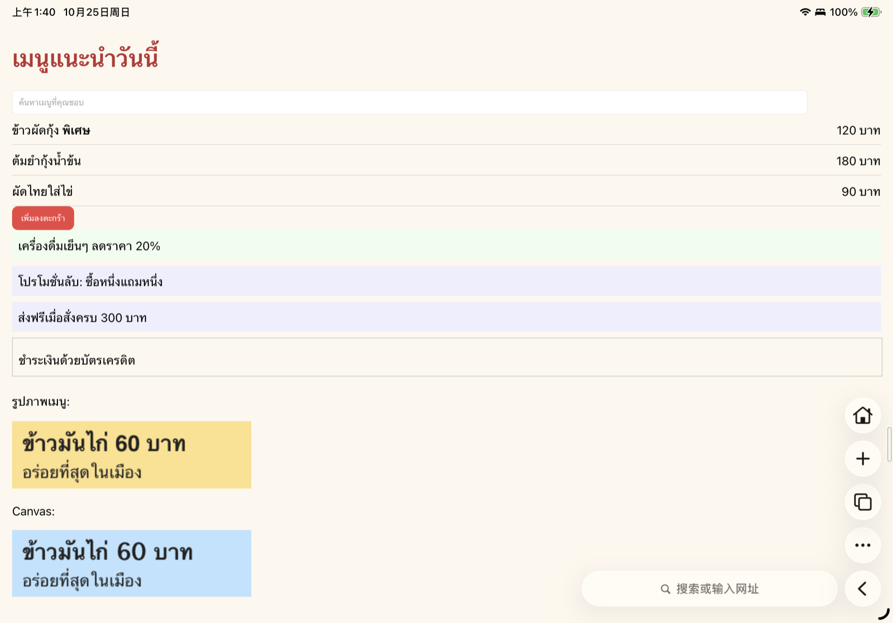 | 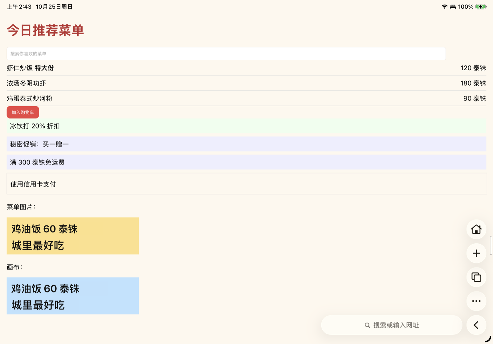 |

**双语对照与长网页**：双语模式把译文放在原文下方；云端引擎只翻屏幕附近的内容，滚到哪翻到哪。

| 双语对照（系统翻译） | 泰文维基百科（Gemini） |
| --- | --- |
| 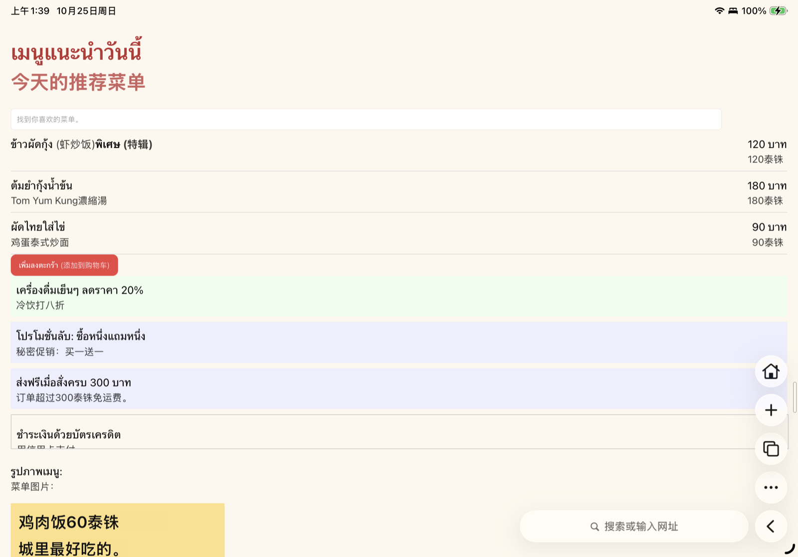 | 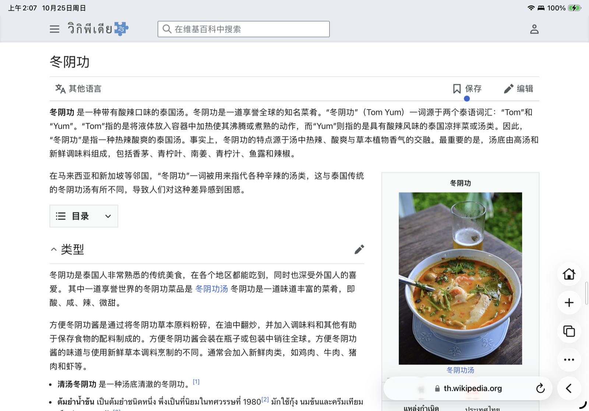 |

在网页的「⋯」菜单里点「翻译网页」，或在网站设置里打开「自动翻译此网站」。引擎在「设置 → 网页翻译」里选：

| 引擎 | 特点 |
| --- | --- |
| 系统翻译（iOS 18+） | 免费，本机离线，最快；第一次翻译某种语言时提示下载语言包 |
| ChatGPT（默认 gpt-5.4-mini） | 译文更自然，首屏约 5–10 秒；接口地址可换成其他兼容 OpenAI 的服务 |
| Gemini（默认 gemini-flash-lite-latest） | 译文更自然，首屏约 5–10 秒；免费额度按每天请求次数计算 |

Safari 的图片翻译用的是 VisionKit 未公开的接口，第三方 App 用不了，所以图片文字用 Vision 识别后自己盖译文。

视频画面来自 Blender Foundation 的 [Big Buck Bunny](https://peach.blender.org/)；[YouTube 播放示例](https://www.youtube.com/watch?v=aqz-KE-bpKQ)，[W3C 托管的下载示例](https://media.w3.org/2010/05/bunny/trailer.mp4)。视频及站点标识归各自权利人所有。点餐页是自己写的测试页；维基百科截图来自泰文维基百科 [ต้มยำ](https://th.wikipedia.org/wiki/ต้มยำ) 条目，内容按 [CC BY-SA 4.0](https://creativecommons.org/licenses/by-sa/4.0/) 授权。

## 特性

- **单手操作友好**：常用操作集中在底部与屏幕侧边；边缘竖线可上下拖动、切换左右侧，视频播放控制列也可拖到另一侧，适应左右手握持。
- **沉浸浏览**：没有常驻工具栏，只在屏幕边缘留一根细竖线，点一下才展开 Safari 风格的液态玻璃工具栏；状态栏底色和 iOS 26 Safari 一样，采样页面顶部的实际颜色。
- **不挡画面的视频播放器**：网页视频全屏时不进系统播放器，而是在页面内铺满，由原生层画控件。
  - 贴近底边的细玻璃进度条，支持相对拖动（任意位置按下拖）和绝对定位（按住进度竖线或点击）
  - 快退 10 秒 / 播放暂停 / 快进 10 秒竖排在屏幕一侧，可以拖到另一侧，没有任何蒙版
  - 保留网页的字幕轨道、音轨，支持倍速、自动横屏
  - 支持跨域 iframe 里的播放器、MSE / HLS 视频
- **广告过滤**：
  - 订阅 EasyList、AdGuard 中文、uBlock filters 等规则，在本机转换成 WebKit 内容拦截规则（约 7.5 万条）
  - 网页内脚本引擎执行 uBO scriptlet 和过程式选择器（`:has-text`、`:upward` 等）
  - 手动屏蔽页面元素、按网站停用过滤
- **网页翻译**：
  - 文字显示出来就翻：动态插入、展开的内容、Shadow DOM、iframe、输入框提示文字
  - 图片、canvas、背景图里的文字在本机识别后，用同样的底色把译文盖在原位
  - 替换原文或双语对照；按网站自动翻译
  - 引擎可选系统翻译（离线免费）、ChatGPT、Gemini，API Key 只存在本机钥匙串
- **支持 iPad**：横竖屏、分屏、台前调度；首页收藏、搜索页收藏、标签页列表都按屏幕宽度增加列数，全屏播放不强制转屏
- **无痕模式**、**历史记录**（带网站图标）、**按网站禁止跳转 App**、**按网站禁止弹出新标签页**、**地区与语言**（让 Google、YouTube 等按指定地区显示）
- **首页**：Metal 实时渲染的星球、行星环和弯曲的时空网格

## 构建

需要 Xcode 26+ 和 [XcodeGen](https://github.com/yonaskolb/XcodeGen)，没有任何第三方依赖。

```bash
xcodegen generate
open Aether.xcodeproj
```

真机签名：新建 `Config/Local.xcconfig`（已在 .gitignore 里），写上自己的团队：

```
DEVELOPMENT_TEAM = XXXXXXXXXX
```

## 说明

- 广告规则列表在运行时从各自官方地址下载，版权归原作者所有，仓库里只有一份自己写的少量内置规则（`Aether/AdBlock/aether-builtin.txt`）。
- 选 ChatGPT 或 Gemini 翻译时，网页文字（包括图片里识别出的文字）会发送给对应服务，按各自的计费和隐私条款处理；系统翻译全程在本机完成。
- 拦截通用链接（禁止跳转 App）用的是 WebKit 未公开的导航策略取值，自用没问题，上架 App Store 前需要评估。

## 许可证

[GNU AGPL-3.0](https://www.gnu.org/licenses/agpl-3.0.html)，全文见 [LICENSE](LICENSE)：

- 可以自由使用、修改、分发，包括商用
- 分发修改后的版本（包括以网络服务形式提供）时，必须以 AGPL-3.0 公开完整源码
- 必须保留原作者的版权和许可证声明

Copyright (C) 2026 Tank Xu
